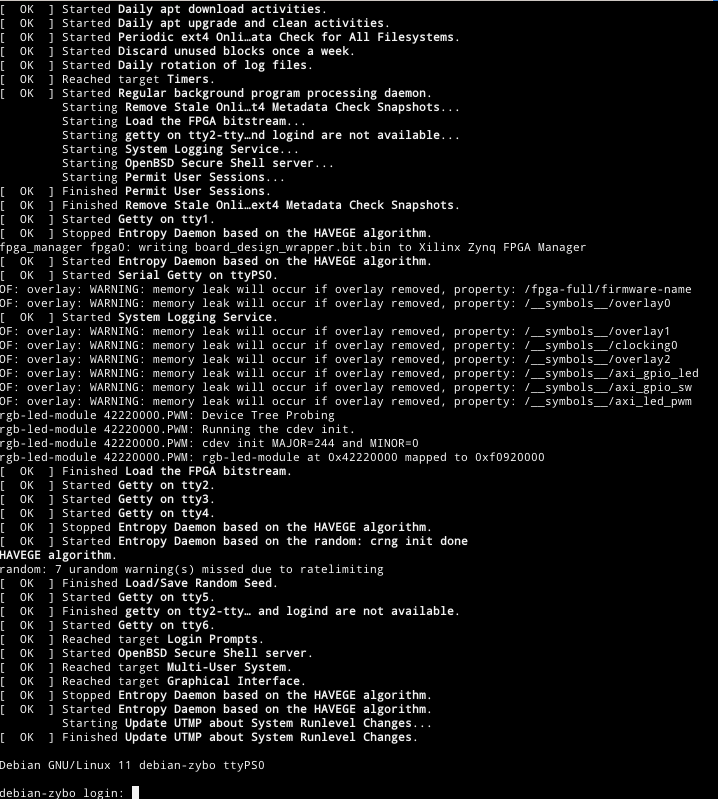
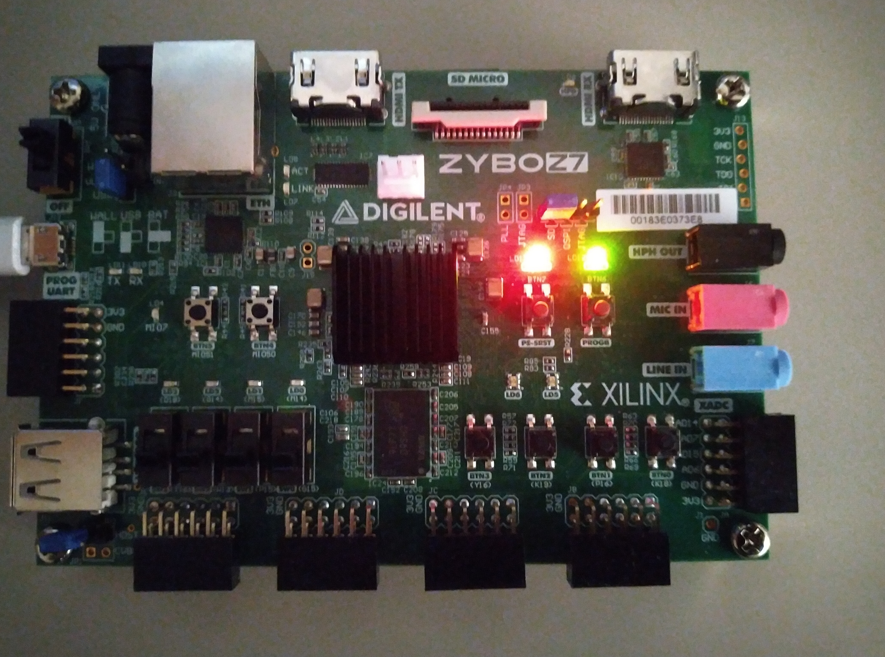

# Build the Debian Image for Zybo

## Required packages and SW

You need to install the following packages:

* flex
* bison
* git
* build-essential
* qemu-user-static
* debootstrap
* binfmt-support
* libssl-dev
* bc
* u-boot-tools

For example, on Debian/Ubuntu systems:

```bash
sudo apt install flex bison git build-essential qemu-user-static debootstrap \
    binfmt-support libssl-dev bc u-boot-tools
```

You also need to have the cross-compiler tools installed on your system. In my case, I have chosen the toolchain
from Vivado / Vitis 2026.1 (sourced into PATH, providing `arm-linux-gnueabihf-`, `bootgen`, `vitis`, and `sdtgen`),
but you can also install the `gcc-arm-linux-gnueabihf` package for cross-compilation.

> [!NOTE]
> Starting with Vitis 2026.1, legacy XSCT has been disabled in favor of the Vitis Unified Python API (`vitis -s`)
> and System Device Tree generator (`sdtgen`). The build scripts automatically utilize this modern flow (refer to Xilinx UG1400).

## Time to build Debian image

The package contains a build script `build-image.sh` which takes care of repo download, patching, artifact build
(Linux kernel, u-boot, FSBL, images preparations, device tree translation) and so on. Run the following command to
get the Debian image (be sure that Vivado/Vitis (or cross-compile toolchain `arm-linux-gnueabihf-`) is usable from the command line):

```bash
./build-image.sh -t
```

The `-t` option collects all required artifacts into `output/tarball` folder - without this, all artifacts will be
in individual project folders and you can take them from there.

Without any arguments, `build-image.sh` performs an incremental build of all missing stages.

### Build Script Options

| Option | Description |
|---|---|
| `-s` | Download sources into cache and copy to `reps/` working tree |
| `-t` | Collect all generated artifacts into `output/tarball` |
| `-f` | Build First-Stage-Boot-Loader (FSBL) |
| `-u` | Build U-BOOT |
| `-k` | Build Linux Kernel |
| `-d` | Build Device Tree (DTB & DTS) |
| `-o` | Build the Debian Rootfs |
| `-b` | Build bootloader (`BOOT.BIN` and `boot.scr`) |
| `-v <distro>` | Debian distribution suite (default: `trixie`) |
| `-j <jobs>` | Number of parallel build jobs (defaults to `$(nproc)`) |
| `-c` | Clean build directory (`output/`) |
| `-m` | Clean everything (`output/`, `reps/`, and `cache/`) |
| `-r` | Rebuild all (cleans `output/` and triggers full build) |
| `-h` | Display help and usage |

### Download Cache Mechanism

To avoid re-downloading multi-gigabyte git repositories (such as `linux-xlnx.git` and `u-boot-xlnx.git`) across rebuilds or after cleanups, a download cache is maintained in `cache/`:

1. **Pristine Cache**: Cloned git repositories are stored unmodified in `cache/` (can be overridden via the `CACHE_FOLDER` environment variable).
2. **Working Tree**: Repositories are copied from `cache/` into `reps/` before build operations. Source tree modifications (such as linking in-tree kernel drivers in `drivers/pb-zybo`) only affect the working copy in `reps/`, leaving the cache pristine.
3. **Cleaning levels**:
   * `./build-image.sh -c`: Deletes only the `output/` build artifacts. `cache/` and `reps/` are preserved.
   * `./build-image.sh -m`: Completely purges `output/`, `reps/`, and `cache/`.
   * If you wish to reset `reps/` to fresh pristine sources without re-downloading from the internet, simply run `rm -rf reps/`. The next run will copy fresh trees from `cache/` instantly.

## SD card preparation

Booting from SD card requires two partitions:

* Boot partition - requires to have FAT32 filesystem, doesn't need to be big (lets say 100MB)
* Root filesystem - the remaining space can be formatted as ext4 (you need to change the fstab configuration in `scripts/bootstrap-debian-image.sh` script)
* Swap partition is not needed but you can set it up if you need :-)

It is time to mount partitions to be ready for the deploy phase - we need to mount root and `boot` into root

```bash
mkdir root_part
mount /dev/mmcblkp2 root_part
mkdir root_part/boot
mount /dev/mmcblkp1 root_part/boot
```

## How to deploy

Seems like you were able to format and mount all partitions :-). The next step is to unpack the rootfs tarball
(from the build stage) into mounted folders. You can check the output using the `ls root_part` you should see the standard folder structure in Linux system.

```bash
tar --preserve-permissions -xzvf output/tarball/debian-trixie-rootfs-vanilla.tgz -C root_part
```

The next step is to copy files from the tarball folder (`output/tarball`) into the `root_part/boot` directory (or FAT boot partition):

* _BOOT.BIN_ - boot image with FSBL (First Stage BootLoader) and U-Boot. The first step in booting is that Zynq
checks the first partition (FAT32) and executes `BOOT.BIN`.
* _boot.scr_ - this file contains the U-Boot script which loads the Linux kernel, initramfs, and device tree, and boots the system.
* _zynq-debian.dtb_ - device tree blob containing peripheral descriptions for the Zybo board, used by the Linux kernel.
* _uImage_ - compiled Linux kernel image for ARM/Zynq.
* _initramdisk.image.gz_ - U-Boot wrapped initial ramdisk image.

The kernel is compiled directly (`uImage` + kernel modules) and installed straight into the rootfs (`/boot` and `/lib/modules/`) and `output/tarball`, avoiding Debian package cross-dependency issues.

The last step is to umount the structure and try to boot.

```bash
umount --recursive root_part
```

## Booting

Now is time to insert the SD card into the slot, turn the power on and let fingers crossed. Now, you can connect
to `/dev/ttyUSB1` serial port (baudrate 115200, HW control flow to OFF) like:

```bash
sudo minicom -b115200 -D /dev/ttyUSB1
```

You should see something like on figures - Debian Linux login screen and green LED on which means that bitstream
was successfully configured.




Default passwords and users:

* user: *root*, password: *root*
* user: *fpga*, password: *fpga*

Also notice you are using this on your own risk!

Enjoy!

## References

* <https://xilinx-wiki.atlassian.net/wiki/spaces/A/pages/460653138/Xilinx+Open+Source+Linux>
* <https://www.xilinx.com/html_docs/xilinx2021_1/vitis_doc/>
* <https://ohwr.org/project/soc-course/wikis/Linux-Kernel-Image-and-Modules>
* <https://u-boot.readthedocs.io/en/stable/usage/booti.html>
* <https://github.com/Kampi/Zybo-Linux/blob/master/docs/wiki/Prepare-a-SD-Card.md>
* <https://github.com/Kampi/Zybo-Linux>
* <https://github.com/PyHDI/zynq-linux>
* <https://xilinx-wiki.atlassian.net/wiki/spaces/A/pages/18842223/U-boot>
* <https://github.com/Netgate/meta-ubmc/blob/master/scripts/uEnv.txt-example>
* <https://www.denx.de/wiki/DULG/LinuxKernelArgs>
* <https://xilinx-wiki.atlassian.net/wiki/spaces/A/pages/18841645/Solution+Zynq+PL+Programming+With+FPGA+Manager#SolutionZynqPLProgrammingWithFPGAManager-UsingDeviceTreeOverlay%3A>
